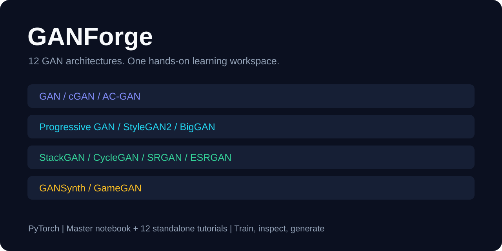

# GANForge



**Explore 12 landmark generative adversarial networks through hands-on PyTorch notebooks.**

GANForge is an educational collection spanning image generation, class conditioning, high-resolution synthesis, style control, text-to-image generation, unpaired translation, super-resolution, audio synthesis, and game-frame prediction. Each section combines explanations, data preparation, model definitions, losses, training, and inference.

The implementations are compact learning adaptations, with small training runs. They do not reproduce the training scale or benchmark results of the original papers. The banner is a project overview graphic, not a trained-model output.

## Start here

- [Master notebook](GANForge_Master_Notebook.ipynb): all architectures, shared utilities, and a bonus unified inference hub.
- [Open in Google Colab](https://colab.research.google.com/github/vams2krish/GANForge/blob/main/GANForge_Master_Notebook.ipynb).
- Choose a standalone tutorial below to study one model independently.

## Architecture guide

| Tutorial | Learning focus |
| --- | --- |
| [Original GAN](standalone_notebooks/GANForge_01_GAN.ipynb) | Unconditional generation from noise |
| [cGAN](standalone_notebooks/GANForge_02_cGAN.ipynb) | Class-conditional generation |
| [AC-GAN](standalone_notebooks/GANForge_03_ACGAN.ipynb) | Conditional generation and auxiliary classification |
| [Progressive GAN](standalone_notebooks/GANForge_04_ProgressiveGAN.ipynb) | Progressive growth for higher-resolution synthesis |
| [StyleGAN2](standalone_notebooks/GANForge_05_StyleGAN2.ipynb) | Style modulation, mixing, and face synthesis |
| [BigGAN](standalone_notebooks/GANForge_06_BigGAN.ipynb) | Class conditioning, attention, and spectral normalization |
| [StackGAN](standalone_notebooks/GANForge_07_StackGAN.ipynb) | Two-stage text-conditioned image generation |
| [CycleGAN](standalone_notebooks/GANForge_08_CycleGAN.ipynb) | Unpaired translation and cycle consistency |
| [SRGAN](standalone_notebooks/GANForge_09_SRGAN.ipynb) | Perceptual single-image super-resolution |
| [ESRGAN](standalone_notebooks/GANForge_10_ESRGAN.ipynb) | RRDB blocks and relativistic adversarial super-resolution |
| [GANSynth](standalone_notebooks/GANForge_11_GANSynth.ipynb) | Audio synthesis through spectral representations |
| [GameGAN](standalone_notebooks/GANForge_12_GameGAN.ipynb) | Action-conditioned next-frame prediction |

## Features

- Shared device selection, random seeds, weight initialization, image display, loss tracking, and checkpoint helpers.
- Editable epoch counts, batch sizes, and image sizes for lightweight experiments.
- Dataset download attempts and synthetic fallback paths for demonstrations when data is unavailable.
- Optional pretrained inference paths, including StyleGAN2 and BigGAN, where compatible dependencies and weights are available.
- Standalone notebooks include shared setup; the standalone ESRGAN notebook also includes the infrastructure it shares with SRGAN in the master notebook.

## Google Colab

1. Open the master notebook above, or upload a standalone notebook to Colab.
2. Select **Runtime → Change runtime type → GPU** when available.
3. Run setup cells, install missing dependencies, and execute your chosen section in order.
4. Inspect outputs and losses, then save checkpoints before the runtime disconnects.

Start with GAN, cGAN, or AC-GAN. Running every architecture takes substantially more resources than running one tutorial.

## Local setup

Use a Python version supported by your selected PyTorch build. A CUDA-capable GPU is recommended; CPU execution can be slow.

```bash
git clone https://github.com/vams2krish/GANForge.git
cd GANForge
python -m venv .venv
```

Activate the environment on Windows PowerShell:

```powershell
.venv\Scripts\Activate.ps1
```

Or on macOS/Linux:

```bash
source .venv/bin/activate
```

Install core dependencies and launch Jupyter:

```bash
python -m pip install --upgrade pip
python -m pip install torch torchvision torchaudio numpy matplotlib tqdm pillow jupyterlab
jupyter lab
```

Choose compatible torch, torchvision, and torchaudio versions for your platform and CUDA runtime. Dependencies are not version-pinned. Optional paths may also require `datasets`, `soundfile`, `torchmetrics`, `pytorch-fid`, `clean-fid`, or `pytorch-pretrained-biggan`. GANSynth imports torchaudio directly.

Select the environment's notebook kernel and execute cells in order. In the master notebook, run Section 0 before any model section; ESRGAN additionally reuses SRGAN infrastructure. The inference hub requires the corresponding models to have been initialized first.

## Project structure

```text
GANForge/
├── README.md
├── GANForge_Master_Notebook.ipynb
├── build_notebook.py
├── build_split_notebooks.py
├── standalone_notebooks/       # 12 independent tutorials
└── docs/
    └── ganforge-overview.svg
```

Runtime directories such as `data/`, `checkpoints/`, and `samples/` are excluded from Git. Downloaded NVIDIA StyleGAN2-ADA source, environment files, and caches also stay local. Datasets and trained weights are not distributed here.

## Regenerate notebooks

The generator scripts use the Python standard library. Run from the repository root:

```bash
python build_notebook.py
python build_split_notebooks.py
```

The first command rebuilds the master notebook; the second generates the standalone notebooks, including ESRGAN's independent setup. Regeneration overwrites generated notebooks, so preserve experiments and execution outputs separately first. Make content edits in the generators when you want them to survive regeneration.

## Data and pretrained models

Read each notebook's data preparation section before training. Examples include small vision datasets, optional horse-to-zebra data for CycleGAN, low/high-resolution pairs, synthetic text/image pairs, audio examples, and a synthetic game environment. Synthetic fallbacks demonstrate the training flow and do not establish real-data quality.

The optional StyleGAN2 loader downloads `NVlabs/stylegan2-ada-pytorch` and externally hosted pretrained weights at runtime. BigGAN uses the optional `pytorch-pretrained-biggan` package. External code, datasets, and weights retain their own licenses and usage conditions. Downloads and pretrained paths require network access and compatible dependencies.

## Limitations

- Short training runs may produce noisy outputs or mode collapse.
- Larger models need more memory and time; reduce batch size, resolution, or epochs when needed.
- Fallback data does not guarantee that every dependency or optional path works offline.
- Fixed seeds help comparison, but hardware and nondeterministic operations can still affect results.
- Publication checks cover notebook structure and documentation; all training sections have not been validated end to end as part of this release.

## Contributing

Report the notebook, cell, environment, and error when opening an issue. For content changes, update the generator, regenerate affected notebooks, and describe the checks performed. Keep datasets, private files, and large checkpoints out of commits.

## License

No project-wide license has been selected. Contact the owner about reuse permissions. Third-party resources remain subject to their own licenses.
